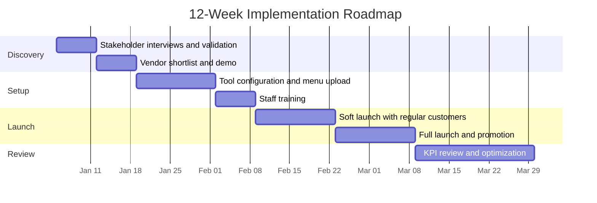

# Roadmap, Governance, and Risks

## 1. Implementation roadmap

## 2. RACI matrix
R = Responsible, A = Accountable, C = Consulted, I = Informed.

| Activity | Owner | Business analyst | Head baker | Counter staff | Vendor |
|----------|-------|------------------|------------|---------------|--------|
| Approve budget | A | C | I | I | I |
| Gather requirements | A | R | C | C | I |
| Configure tool | I | A | C | C | R |
| Train staff | I | A | I | R | C |
| Launch and promote | A | R | I | C | C |
| Review KPIs | A | R | C | I | I |

## 3. Risk register
Score = Probability (1-5) x Impact (1-5).

| ID | Risk | Prob. | Impact | Score | Mitigation | Owner |
|----|------|-------|--------|-------|-----------|-------|
| R1 | Customers keep phoning instead of ordering online | 4 | 3 | 12 | Counter signage, a link in phone greeting, small first-order discount | Owner |
| R2 | Staff resist the new process | 3 | 4 | 12 | Involve staff in testing, short hands-on training | Analyst |
| R3 | Unreliable internet at the shop | 3 | 4 | 12 | Backup mobile data, printed order list at 6 AM | Owner |
| R4 | Overselling during peak days | 2 | 4 | 8 | Slot capacity limits and sold-out control | Head baker |
| R5 | Vendor price increase | 2 | 3 | 6 | Annual contract, review alternatives at renewal | Owner |
| R6 | Customer data privacy concern | 2 | 5 | 10 | Use certified payment provider, collect minimum data | Analyst |

## 4. KPI dashboard design
| KPI | Baseline | Target | Source | Frequency |
|-----|----------|--------|--------|-----------|
| Order error rate | 8% | Under 3% | Refund and remake log | Weekly |
| Online order share | 0% | 40% by month 6 | Tool report | Weekly |
| After-hours orders | 0% | 10% by month 6 | Tool report | Weekly |
| Missed-call rate (peak) | 18% | Under 5% | Phone log | Monthly |
| Average order value | ₦6,500 | ₦7,000 | Tool report | Monthly |
| Customer satisfaction | n/a | 4.5 / 5 | Post-pickup survey | Monthly |

## 5. Success criteria for go/no-go at week 12
- At least 25% of orders placed online
- Error rate trending below 5%
- No critical incidents in the last 2 weeks
- Staff confidence rating of 4 / 5 or higher
